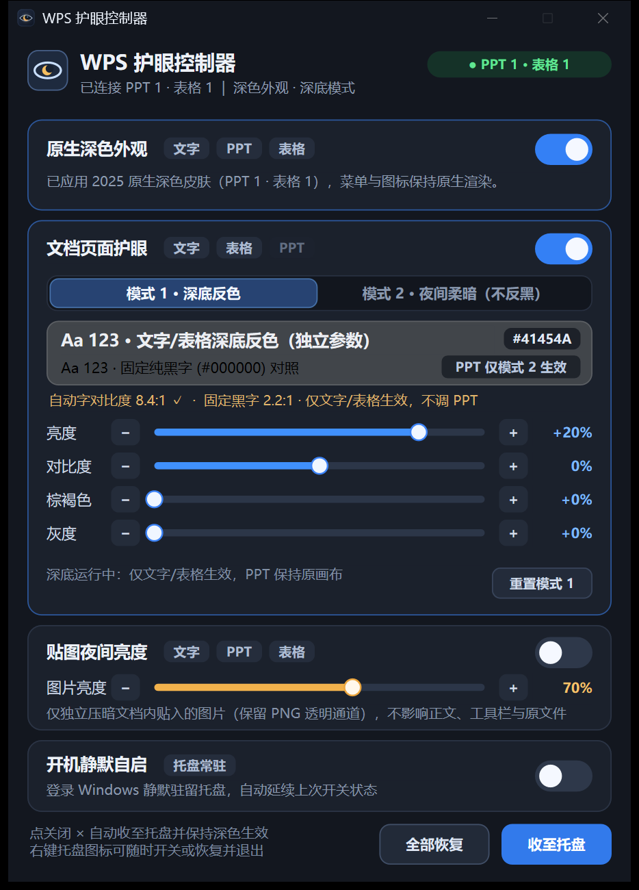
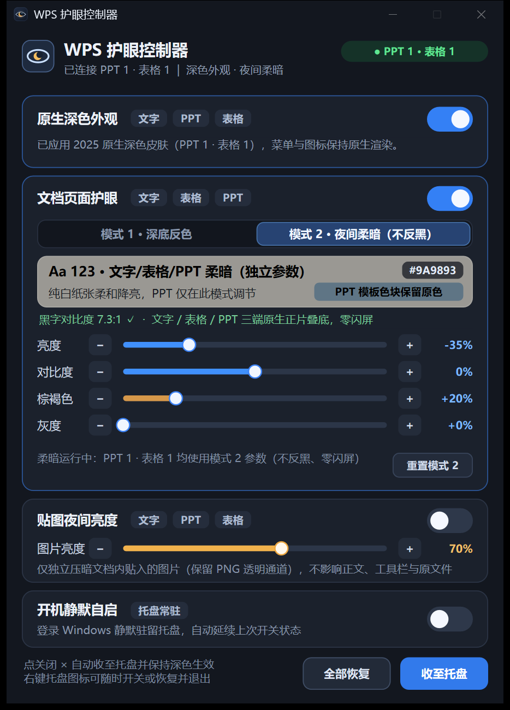
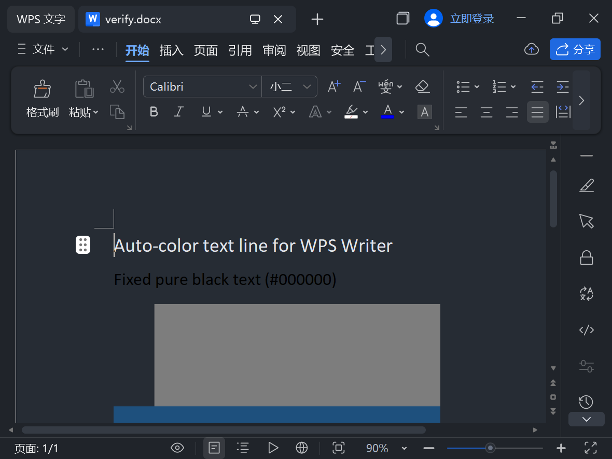
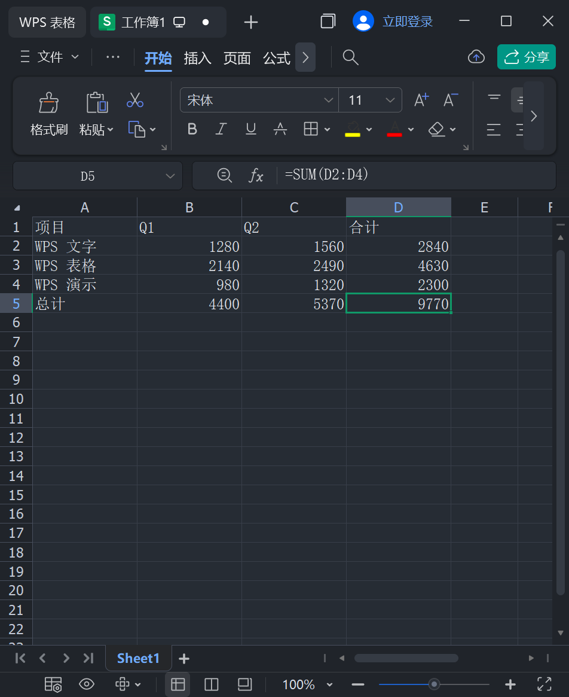
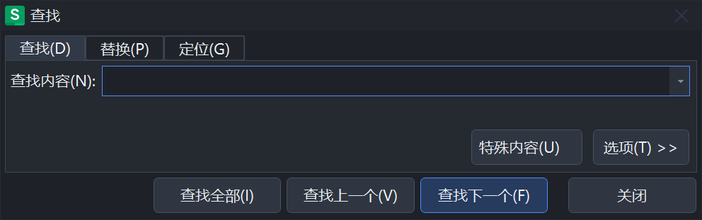
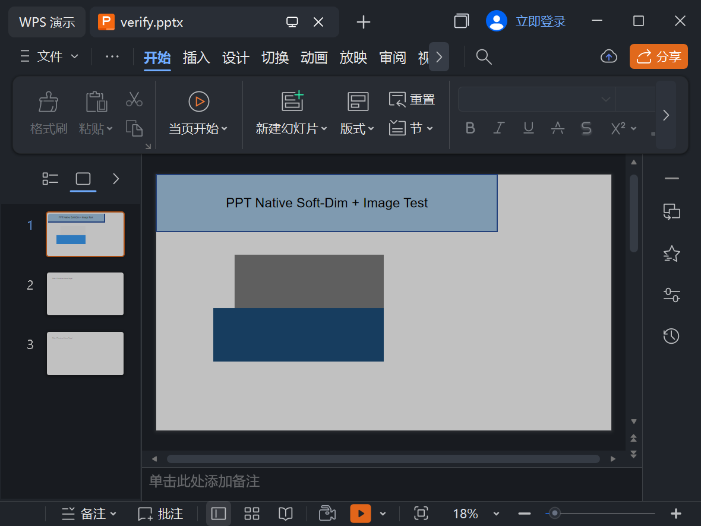

# WPS 护眼控制器（WPS Eye Comfort）

轻量级 **纯 Rust + Win32 + Direct2D/DirectWrite + 32 位原生渲染辅助 DLL** 编写的 Windows WPS Office 护眼与原生深色外观工具。  
零 Python、零 Electron、零 WebView2、**零录屏遮罩、零黄框、零闪屏**，单文件开箱即用，完整支持 **WPS 文字（Word）/ 表格（Excel）/ 演示（PPT）** 三端。



## 核心特性

- **极小单文件体积**：[WPS-Eye-Comfort-Rust.exe](WPS-Eye-Comfort-Rust.exe) 仅 **~1.0 MB**，已内置 32 位原生辅助 DLL、校验清单与双态托盘图标，直接双击运行。
- **超低内存托盘常驻**：点关闭 `×` 或「收至托盘」自动隐藏面板并释放 Direct2D/DirectWrite 渲染资源，保持护眼与深色生效；静默托盘常驻工作集仅 **0.25–3.5 MB**，且画布柔暗与贴图压暗均在 WPS 原有渲染管线内原地完成，不新增额外窗口或录屏帧缓冲。
- **原生 2025 深色外观（文字 · PPT · 表格）**：动态生成 `.kuip` + Qt RCC 深色皮肤并调用 WPS 原生换肤接口，完整覆盖主界面、**WPS 表格公式栏（`fx`）** 以及 **「查找 / 替换 / 定位」等原生 `KFundamentalDialog` 弹窗**（已打开弹窗实时同步换色），保留原版图标与顶部菜单，三端同开不回弹。
- **双模式文档页面护眼（独立调参 · 零闪屏）**：
  - **模式 1 · 深底反色（仅文字 / 表格）**：WPS 文字采用原生 `BlueScreen` 深底浅字；WPS 表格原生重映射单元格白底、黑字与网格线为深色暗格并保留彩底与原图；**PPT 保持原始画布不做调节**。
  - **模式 2 · 夜间柔暗（文字 / 表格 / PPT 不反黑）**：在 **文字 / 表格 / PPT** 三端画布上执行原生正片叠底（Multiply）光学压暗，纯白纸张与表格柔和降亮、纯黑正文保持锐利黑字、PPT 彩色色块按比例保留原色；鼠标快速掠过 PPT 左侧缩略图 **零闪屏、零错位**，进入 F5 全屏放映与双屏演示者视图自动保留原色。
  - **两套模式参数完全独立**：模式 1 与模式 2 各自独立保存 **亮度 / 对比度 / 棕褐色 / 灰度** 四个实时滑块与「重置模式 1 / 重置模式 2」按钮，互不干扰，内置 WCAG ≥ 4.5:1 可读性兜底。
- **独立「贴图夜间亮度」控制条（25%–100%）**：
  - 独立开关与琥珀色滑块，通过 WPS 原生 `QImageEffects` 仅压暗文档内贴入的图片（Word / Excel / PPT 三端生效），**100% 保留 PNG 透明通道**，不影响正文文字、界面图标、PPT 放映与原文档文件。
- **开机静默自启（免管理员权限）**：写入当前用户启动项 `HKCU\Software\Microsoft\Windows\CurrentVersion\Run`，开机静默驻留托盘并自动延续上次三项开关状态。
- **严格校验与无损恢复**：连接前对 WPS 二进制执行 SHA-256 + RVA 特征校验，绝不修改 WPS 安装文件与文档内容；缓存多标签 WPS 文字 COM 会话（切标签/关文档切换模式无报错），自动清理已关窗的 WPS 后台残留进程，一键「全部恢复」或「恢复原版并退出」稳定无卡死。

## 实机测试画面

截图环境为 Windows 11 和 WPS Office 12.8.2.19823（32 位），基于 `v1.1.0` 实拍。

### 控制面板 · 双模式独立调参（模式 1 深底反色 / 模式 2 夜间柔暗）

| 模式 1 · 深底反色（仅文字 / 表格，PPT 保持原画布） | 模式 2 · 夜间柔暗（文字 / 表格 / PPT 三端生效） |
| :---: | :---: |
|  |  |

### WPS 文字（Word · 模式 1 深底反色与贴图降亮）



### WPS 表格（Excel · 模式 1 深底反色与深色公式栏）



### WPS 原生弹窗（查找 / 替换 / 定位 · `KFundamentalDialog` 深色同步）



### WPS 演示（PowerPoint · 模式 2 夜间柔暗与贴图降亮，零闪屏）



## 快速使用

1. 直接双击根目录的 [WPS-Eye-Comfort-Rust.exe](WPS-Eye-Comfort-Rust.exe)（建议放到常用固定目录）。
2. 打开 WPS 文字、表格或演示（PPT），按需开启 **原生深色外观**、**文档页面护眼（模式 1 深底反色 / 模式 2 夜间柔暗）** 与 **贴图夜间亮度**。
3. 点击右上角 `×` 或 **收至托盘** 隐藏窗口，护眼效果保持生效；右键托盘图标可随时快捷切换三项开关、开启 **开机自动启动（静默托盘）** 或 **恢复原版并退出**。

### 命令行参数

| 参数 | 说明 |
| --- | --- |
| `--minimized` | 启动后直接隐藏到系统托盘（不弹窗、延迟加载图形引擎） |
| `--auto-start` | 自动延续上次保存的外观、页面护眼与贴图夜间亮度开关状态 |
| `--enable-skin` | 启动时强制开启三端原生深色外观 |
| `--enable-page` | 启动时强制开启三端文档页面护眼 |
| `--enable-img` | 启动时强制开启三端贴图夜间亮度压暗 |

## 适用环境与边界说明

- **已实测验证环境**：Windows 10 / 11 + **WPS Office 12.8.2.19823（32 位 x86）**。
- **安全版本锁定**：原生接口强依赖二进制校验清单 `native/v3/manifest.json`；若本地 WPS 版本不一致，程序会主动拒绝注入并给出提示，避免崩溃或异常。
- **文档内固定颜色文字**：在 **模式 1（深底反色）** 下，WPS 文字原生接口仅控制纸张底色与「自动颜色」文字，文档内显式设为纯黑 `#000000` 或彩色的文字保持原值；遇到含大量固定黑字或彩色配色的文档/表格/PPT 时，可直接切换 **模式 2（夜间柔暗 · 不反黑）**。
- 配置文件与临时生成的深色皮肤缓存位于 `%LOCALAPPDATA%\WpsNativeEye`，不触碰 WPS 安装目录。

## 目录结构

```text
WPS-eye-comfort/
├── WPS-Eye-Comfort-Rust.exe     # 独立单文件成品（~1.0 MB，开箱即用）
├── wps-eye-rust/                # 纯 Rust + Direct2D + Win32 托盘控制器源码
│   ├── Cargo.toml
│   ├── build.rs                 # 编译并嵌入图标与 DPI 清单资源
│   ├── assets/                  # 矢量生成的多尺寸双态图标与 Win11 清单
│   └── src/
│       ├── main.rs              # 窗口消息循环、单实例与生命周期管理
│       ├── ui_d2d.rs            # Direct2D / DirectWrite 暗色 Fluent 面板（双模式 + 独立贴图亮度条）
│       ├── tray.rs              # 原生系统托盘、双态图标与 TaskbarCreated 恢复
│       ├── autostart.rs         # HKCU 注册表开机自启与任务管理器状态检测
│       ├── controller.rs        # 后台 COM 线程、偏好记忆与会话恢复账本
│       ├── native_agent.rs      # 32 位进程模块校验、CNG SHA-256 与协议 v4 通信
│       ├── skin_builder.rs      # 纯 Rust 2025 .kuip + Qt RCC v2 深色皮肤生成器
│       ├── palette.rs           # 四维正交护眼调色、夜间柔暗与 WCAG 对比度算法
│       └── wps_bridge.rs        # WPS 文字原生 COM 对象模型桥接
├── native/                      # 32 位 C++ 原生辅助 DLL 源码与产物
│   ├── build-v3.ps1             # MSVC x86 / Zig 构建脚本
│   ├── v3/                      # 已编译产物 WpsNativeEyeV3.dll 与 manifest.json
│   ├── v3-src/                  # C++ 源码（协议 v4 换肤、页内显示选项与三端画布/贴图原生渲染）
│   └── vendor/minhook/          # MinHook 源码及 BSD 许可
├── build_native_manifest.py     # WPS 导出函数、RVA 字节签名与 SHA-256 清单生成脚本
├── docs/                        # README 预览截图
└── LICENSE
```

## 从源码编译

### 1. 构建 32 位原生 DLL（可选，仓库已附带编译好的 `native/v3/WpsNativeEyeV3.dll`）

需要安装 Visual Studio Build Tools（MSVC x86）与 Python 3.12（含 `pefile`）：

```powershell
powershell -ExecutionPolicy Bypass -File .\native\build-v3.ps1
```

### 2. 构建纯 Rust 单文件 EXE

需要安装 Rust 工具链与 Windows SDK（`rc.exe` / `cvtres.exe`）：

```powershell
cd wps-eye-rust
cargo test
cargo build --release
Copy-Item -Force target\release\wps-eye-comfort.exe ..\WPS-Eye-Comfort-Rust.exe
```

## 开源许可

本项目原创代码采用 [MIT License](LICENSE) 开源；第三方依赖 MinHook 遵循 [native/vendor/minhook/LICENSE.txt](native/vendor/minhook/LICENSE.txt) 中的 BSD 许可。WPS Office 及相关商标归金山软件所有。
